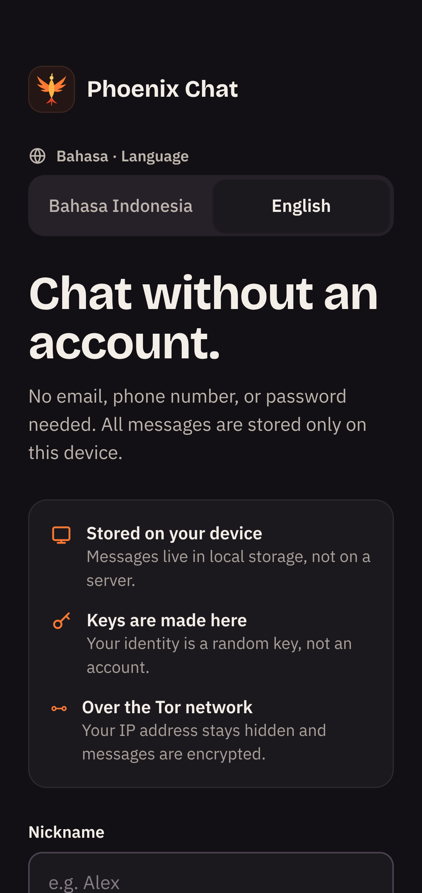
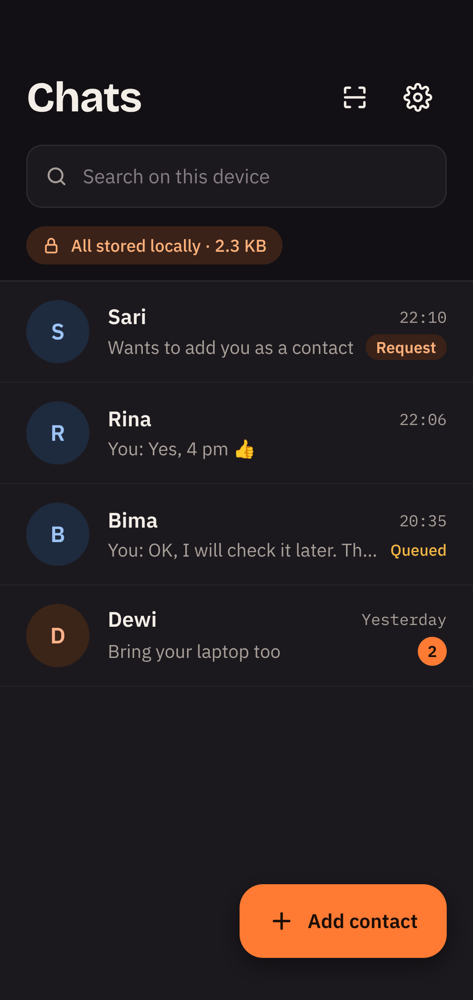
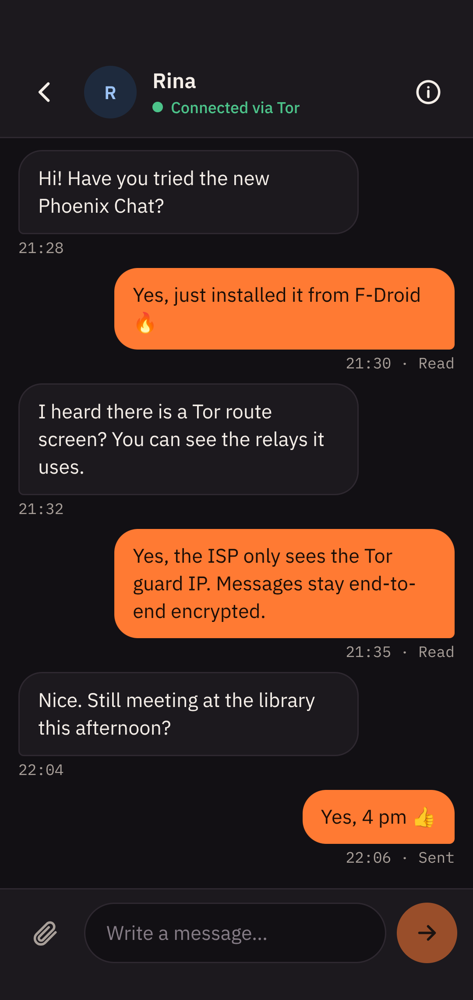
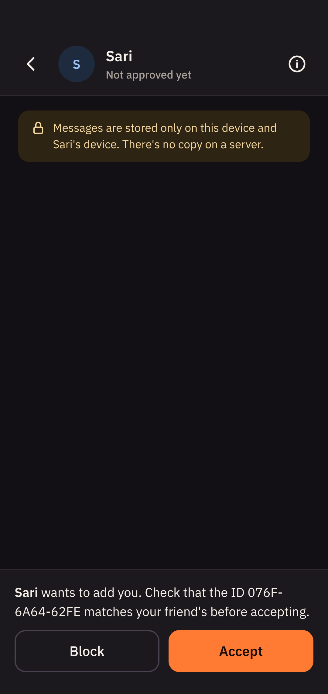
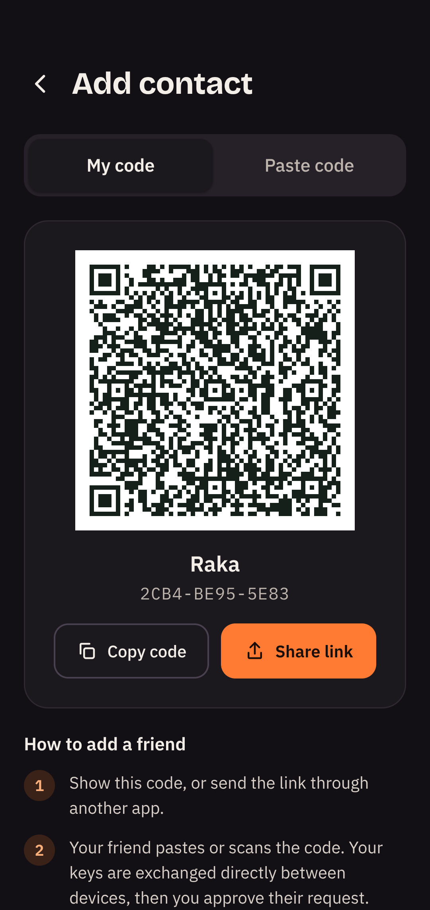
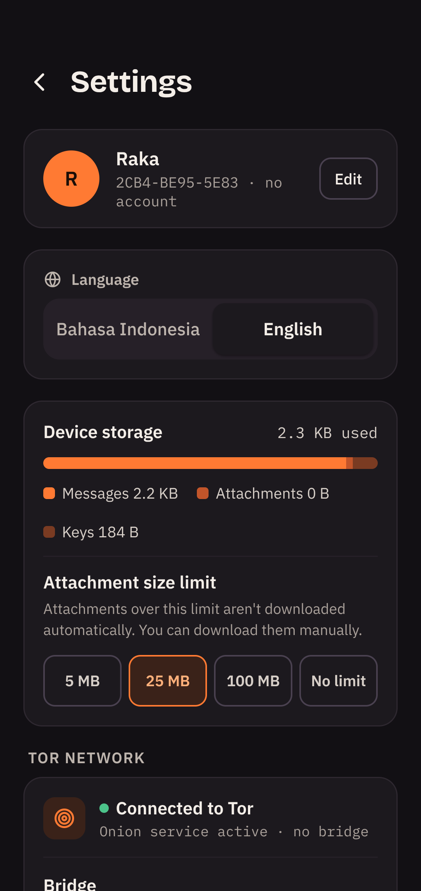
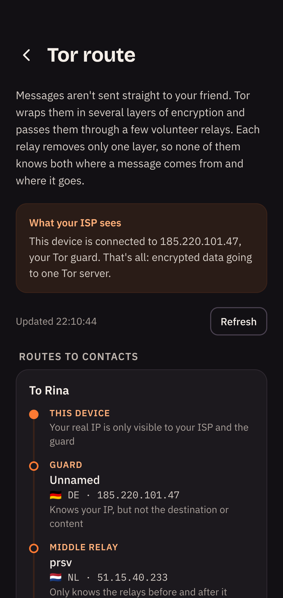

# Phoenix Chat

[Bahasa Indonesia](README.md) · **English**

Phoenix Chat is a chat app with no accounts and no database, with a dark theme and a phoenix logo. Your identity is a random key created on your device, all data is stored as local files, and messages travel directly between devices over Tor onion services with end-to-end encryption.

The design follows the "Desain Aplikasi Chat Lokal" canvas (5 screens) and the architecture follows the "Dokumen Desain — Chat Lokal" design document. There are two versions sharing the same protocol, so their users can chat with each other: a desktop app (Electron, `server/`) and an Android app (Kotlin, `android/`). Both use the same React interface (`src/`).

## Screenshots

<table>
<tr>
<td align="center" width="25%"><br><sub>Start: create an identity without an account</sub></td>
<td align="center" width="25%"><br><sub>Chat list</sub></td>
<td align="center" width="25%"><br><sub>Chat</sub></td>
<td align="center" width="25%"><br><sub>New contact request</sub></td>
</tr>
<tr>
<td align="center" width="25%"><br><sub>Add a contact with a QR code</sub></td>
<td align="center" width="25%"><br><sub>Settings</sub></td>
<td align="center" width="25%"><br><sub>Tor route: the relays a message passes through</sub></td>
</tr>
</table>

## Download

### F-Droid

Phoenix Chat has its own F-Droid repository, so updates arrive automatically through the [F-Droid](https://f-droid.org) app:

1. In F-Droid open **Settings → Repositories → +** (or scan the QR code below).
2. Enter the address `https://delfiboyz.github.io/PhoenixChat/fdroid/repo`
3. Check the repository fingerprint: `AB9796E00CCE332F3D4ED053C5FDF6488714A5B48B172B4522F64CA30ADAFB39`


Phoenix Chat is not in the main F-Droid repository yet: the app uses libraries shipped as prebuilt native binaries (tor-android, IPtProxy, libsodium) that don't meet F-Droid's build-from-source policy.

### Direct download

Ready-to-use files are also on the [Releases](https://github.com/delfiboyz/PhoenixChat/releases) page:

- **Android**: `PhoenixChat-<version>-android-arm64-v8a.apk` for most phones (there are also `armeabi-v7a`, `x86_64`, and `universal`). The SHA-256 fingerprint of the signing certificate is listed in the release notes.
- **Linux**: `PhoenixChat-<version>-x86_64.AppImage`. Requires the `tor` program on the system (`apt install tor`). Run it with `chmod +x PhoenixChat-*.AppImage && ./PhoenixChat-*.AppImage`.

Updating the F-Droid repository after building the release APKs: `scripts/publish-fdroid.sh` (requires `fdroidserver` plus `fdroid/config.yml` and `fdroid/keystore.p12`, which are not in git). The app metadata is in `fdroid/metadata/`.

Building it yourself: `npm run dist:linux` for the AppImage (output in `release/`); see the Android section below for the APK.

## Running

Requires Node 20+ and the `tor` program on the system (`apt install tor`). For bridges, also install `obfs4proxy`/`lyrebird` or `snowflake-client`.

```bash
npm install
```

```bash
npm start
```

`npm start` builds the interface and opens the desktop app. Data is stored in Electron's app data folder (`~/.config/Phoenix Chat/data` on Linux; the old `~/.config/chat-lokal` folder is still used if it exists).

Without Electron, the interface can be opened in a browser:

```bash
npm run build && npm run serve
```

## Android

Requires the Android SDK (compileSdk 37.1, downloaded automatically on the first build) and JDK 17 or 21. Build the interface first, since the APK bundles the contents of `dist/`:

```bash
npm run build
```

```bash
cd android && ./gradlew assembleDebug
```

The APKs are in `android/app/build/outputs/apk/debug/`, one per architecture (`arm64-v8a` for most phones) plus one universal APK. For a signed release APK, create `android/keystore.properties` with `storeFile`, `storePassword`, `keyAlias`, `keyPassword`, then run `./gradlew assembleRelease`.

On Android, Tor runs inside the app (tor-android from the Guardian Project) and the onion service is created with `ADD_ONION`. While *Battery saver mode* is off, a foreground service keeps Tor receiving messages when the app is closed. Android-only features: scanning QR codes with the camera, the Android share menu, `chatlokal:` links that open the Add contact screen, message notifications, and obfs4/Snowflake bridges through IPtProxy.

```
android/app/src/main/java/app/chatlokal/
  core/Core.kt           counterpart of server/core.js
  core/Crypto.kt         counterpart of server/crypto.js (libsodium crypto_box = nacl.box)
  core/Store.kt          counterpart of server/store.js
  net/TorNetwork.kt      TorService + ADD_ONION + bridges + sending over SOCKS (OkHttp)
  net/LocalServers.kt    peer server and UI server, same endpoints as server/http.js
  MainActivity.kt        WebView + JS bridge (save files, copy, share, scan QR)
  ChatService.kt         foreground service
```

Onion keys are stored in tor's `HiddenServiceDir` file format, the same as the desktop version, so backup files can be restored on either platform.

## Development mode without Tor

To test two users on one computer without waiting for Tor, run two profiles in direct mode (messages go over `127.0.0.1`, **not anonymous**):

```bash
npm run build && npm run dev:a
```

```bash
npm run dev:b
```

Each prints an `http://127.0.0.1:530x/#token=…` address to open in a browser. Test data is in `.data/`. To edit the interface with hot reload, run `npm run dev:ui` and open the Vite address with the `#token=…` from profile a.

## Architecture

```
electron/main.cjs      desktop window; blocks navigation away from the local interface
server/index.js        starts Core + two local HTTP servers
server/core.js         identity, contacts, messages, queue, attachments, backups
server/tor.js          own tor process + v3 onion service (HiddenServiceDir)
server/torctl.js       small Tor control port client (reads circuits for the Tor route screen)
server/transport.js    sends to .onion addresses over Tor's SOCKS port
server/http.js         peer server (only /ping and /inbox, mapped to the onion)
                       UI server (127.0.0.1, token required, serves React + API + SSE)
server/crypto.js       nacl.box E2E, device ID, contact codes, backup encryption
server/store.js        local JSON files, written atomically
src/                   React interface: Start, Chats, Chat, Add contact, Settings, Tor route
```

- **Identity**: an X25519 key pair (nacl.box) for encryption, plus the onion service key created by tor. The ID shown (e.g. `7F3A-91C2-B04E`) is a digest of the .onion address.
- **Contacts**: a `chatlokal:…` code contains the name, .onion address, and public key. People who add you appear as a *Request* that you must accept. There is no user directory.
- **Messages**: encrypted with `nacl.box` and sent to the friend's device `/inbox` over Tor. An HTTP 200 reply = *Sent*; a read receipt sent back as an encrypted message = *Read*.
- **Queue**: messages for an offline friend stay in the sender's `outbox.json` with the *Queued* status, are retried with increasing delays, and are sent as soon as the friend is seen online. There is no third-party relay.
- **Attachments**: the sender offers the file; the receiver downloads it automatically if it is below the limit set in Settings, otherwise with the *Download* button.
- **Tor route**: the Tor route screen reads `circuit-status` from Tor's control port and shows the relays this device uses (guard, middle relay, rendezvous point) with their IP and country, plus what your ISP and each relay can see. Chats with .onion addresses never leave the Tor network, so there is no exit node.
- **Backups**: one file containing keys, contacts, messages, and attachments, encrypted with AES-256-GCM using a key from scrypt(password).
- **Languages**: Indonesian and English, chosen on the Start screen (initial guess from the system language) and changeable in Settings. The choice is stored as the `lang` setting on the device, so error messages, Tor status, and notifications follow it. The interface dictionary is in `src/i18n.js`, server messages in `server/i18n.js` and `android/.../core/I18n.kt`.
- **Name and technical identifiers**: the visible name is *Phoenix Chat*, but the `chatlokal:` contact code scheme, the Android package ID `app.chatlokal`, and the backup format are unchanged, so old contact codes, backups, and installations keep working.
- **Fonts** are bundled locally (`@fontsource`), not loaded from Google Fonts, so there are no connections outside Tor.

## Differences from the design

- On desktop, the *Scan code* tab becomes *Paste code*, since desktops usually have no camera. On Android this tab scans QR codes with the camera.
- *Battery saver mode (Android)* only appears on Android.
- A *Send "Read" receipts* switch was added (the document says they can be turned off).
- *Move to a new device* uses an export-then-restore flow.

## Known limitations

- The PIN lock only locks the interface; data files on disk are not encrypted. Protect your operating system account.
- Bridges need bridge addresses you enter yourself (from bridges.torproject.org); the app ships no built-in list.
- Messages are only received while the app is running, since no server holds messages. On Android, this means while the foreground service is active or the app is open.
- On Android, tor-android keeps Tor network data in the cache folder. If the phone's storage is almost full, the system may keep clearing that cache and Tor fails to connect.

## License

Phoenix Chat is free software under the [GNU General Public License v3.0 or later](LICENSE) (`GPL-3.0-or-later`).
