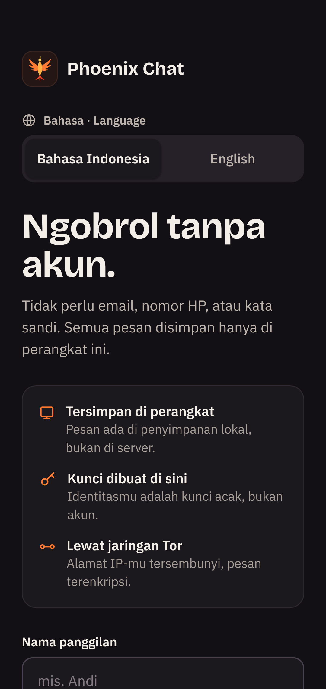
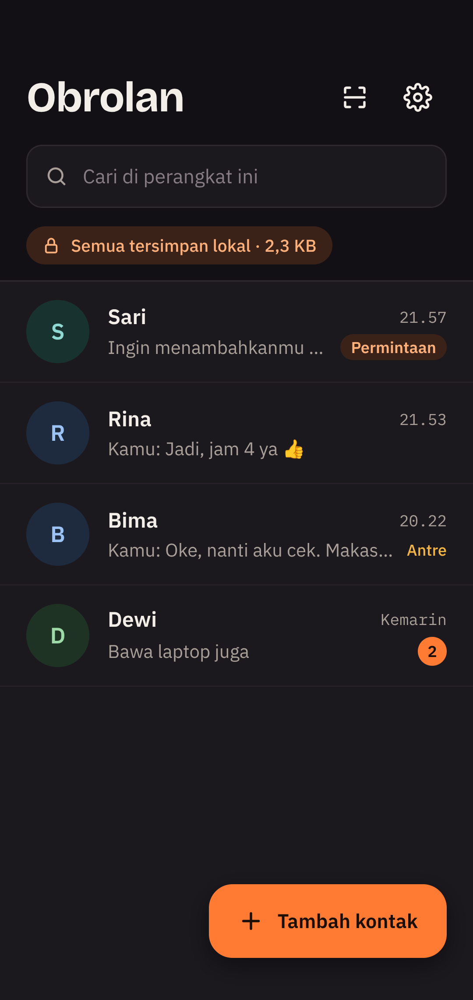
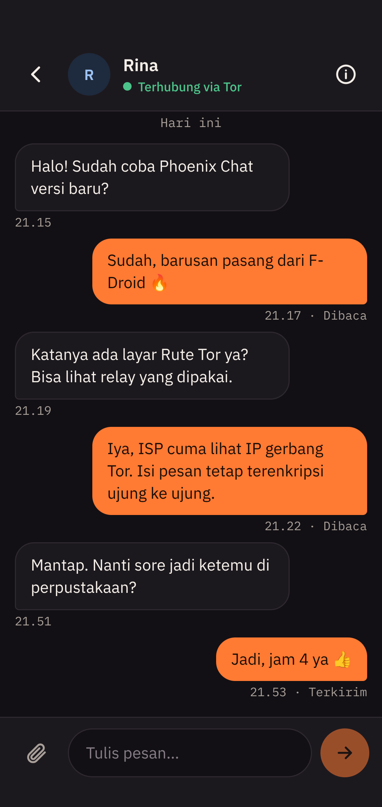
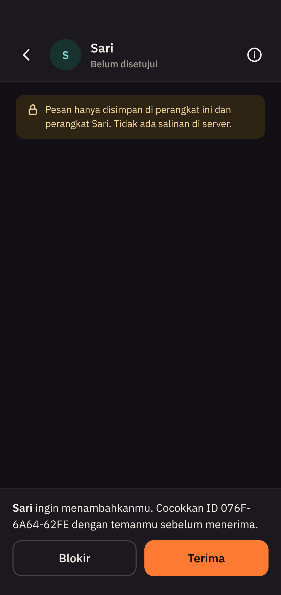
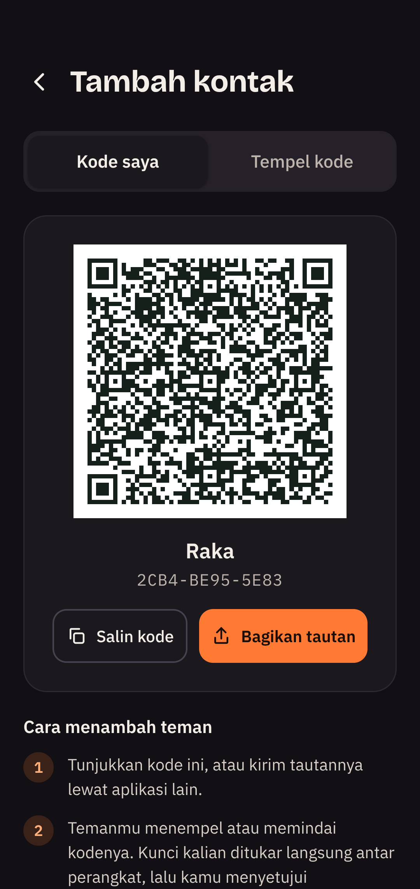
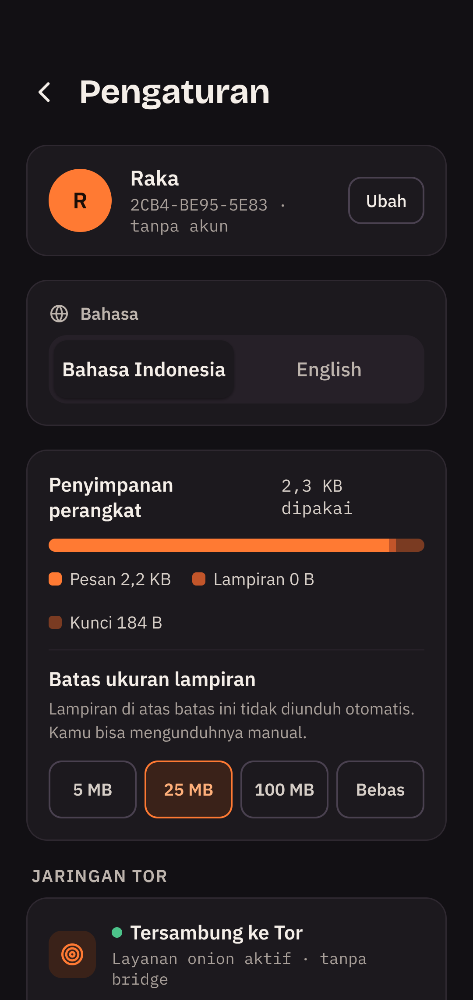
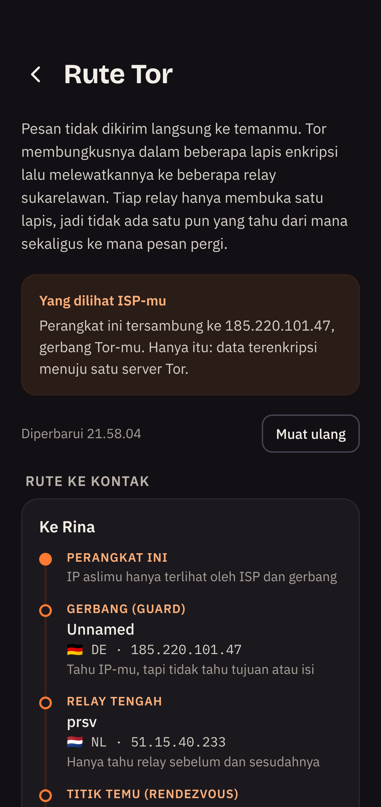

# Phoenix Chat

Phoenix Chat adalah aplikasi chat tanpa akun dan tanpa database, dengan tampilan gelap dan logo phoenix. Identitas adalah kunci acak yang dibuat di perangkat, semua data tersimpan sebagai file lokal, dan pesan dikirim langsung antar perangkat lewat layanan onion Tor dengan enkripsi ujung ke ujung.

Desain mengikuti canvas "Desain Aplikasi Chat Lokal" (5 layar) dan arsitektur mengikuti "Dokumen Desain — Chat Lokal". Ada dua versi dengan protokol yang sama, jadi penggunanya bisa saling mengobrol: aplikasi desktop (Electron, `server/`) dan aplikasi Android (Kotlin, `android/`). Keduanya memakai antarmuka React yang sama (`src/`).

## Tampilan

<table>
<tr>
<td align="center" width="25%"><br><sub>Mulai: buat identitas tanpa akun</sub></td>
<td align="center" width="25%"><br><sub>Daftar obrolan</sub></td>
<td align="center" width="25%"><br><sub>Ruang obrolan</sub></td>
<td align="center" width="25%"><br><sub>Permintaan kontak baru</sub></td>
</tr>
<tr>
<td align="center" width="25%"><br><sub>Tambah kontak dengan kode QR</sub></td>
<td align="center" width="25%"><br><sub>Pengaturan</sub></td>
<td align="center" width="25%"><br><sub>Rute Tor: relay yang dilewati pesan</sub></td>
</tr>
</table>

## Unduh

### F-Droid

Phoenix Chat punya repo F-Droid sendiri, jadi pembaruan datang otomatis lewat aplikasi [F-Droid](https://f-droid.org):

1. Di F-Droid buka **Pengaturan → Repositori → +** (atau pindai kode QR di bawah).
2. Masukkan alamat `https://delfiboyz.github.io/PhoenixChat/fdroid/repo`
3. Pastikan sidik jari repo: `AB9796E00CCE332F3D4ED053C5FDF6488714A5B48B172B4522F64CA30ADAFB39`


Phoenix Chat belum ada di repo utama F-Droid: aplikasi ini memakai pustaka dengan biner native jadi (tor-android, IPtProxy, libsodium) yang belum memenuhi kebijakan build-dari-sumber F-Droid.

### Unduh langsung

File siap pakai juga ada di halaman [Releases](https://github.com/delfiboyz/PhoenixChat/releases):

- **Android**: `PhoenixChat-<versi>-android-arm64-v8a.apk` untuk kebanyakan ponsel (ada juga `armeabi-v7a`, `x86_64`, dan `universal`). Sidik jari SHA-256 sertifikat penandatangan tercantum di catatan rilis.
- **Linux**: `PhoenixChat-<versi>-x86_64.AppImage`. Butuh program `tor` di sistem (`apt install tor`). Jalankan dengan `chmod +x PhoenixChat-*.AppImage && ./PhoenixChat-*.AppImage`.

Memperbarui repo F-Droid setelah membangun APK rilis: `scripts/publish-fdroid.sh` (butuh `fdroidserver` dan `fdroid/config.yml` + `fdroid/keystore.p12`, yang tidak ikut git). Metadata aplikasinya ada di `fdroid/metadata/`.

Membangun sendiri: `npm run dist:linux` untuk AppImage (hasil di `release/`), dan lihat bagian Android di bawah untuk APK.

## Menjalankan

Butuh Node 20+ dan program `tor` di sistem (`apt install tor`). Untuk bridge, pasang juga `obfs4proxy`/`lyrebird` atau `snowflake-client`.

```bash
npm install
```

```bash
npm start
```

`npm start` membangun antarmuka lalu membuka aplikasi desktop. Data disimpan di folder data aplikasi Electron (`~/.config/Phoenix Chat/data` di Linux; folder lama `~/.config/chat-lokal` tetap dipakai jika sudah ada).

Tanpa Electron, antarmuka bisa dibuka di browser:

```bash
npm run build && npm run serve
```

## Android

Butuh Android SDK (compileSdk 37.1, terunduh otomatis saat build pertama) dan JDK 17 atau 21. Bangun antarmuka dulu, karena APK memuat isi `dist/`:

```bash
npm run build
```

```bash
cd android && ./gradlew assembleDebug
```

APK ada di `android/app/build/outputs/apk/debug/`, satu per arsitektur (`arm64-v8a` untuk kebanyakan ponsel) plus satu universal. Untuk APK rilis bertanda tangan, buat `android/keystore.properties` berisi `storeFile`, `storePassword`, `keyAlias`, `keyPassword`, lalu jalankan `./gradlew assembleRelease`.

Di Android, Tor berjalan di dalam aplikasi (tor-android dari Guardian Project) dan layanan onion dibuat lewat `ADD_ONION`. Selama *Mode hemat baterai* mati, layanan foreground menjaga Tor tetap menerima pesan saat aplikasi ditutup. Fitur khusus Android: pindai QR dengan kamera, menu berbagi Android, tautan `chatlokal:` yang membuka layar Tambah kontak, notifikasi pesan, dan bridge obfs4/Snowflake lewat IPtProxy.

```
android/app/src/main/java/app/chatlokal/
  core/Core.kt           padanan server/core.js
  core/Crypto.kt         padanan server/crypto.js (libsodium crypto_box = nacl.box)
  core/Store.kt          padanan server/store.js
  net/TorNetwork.kt      TorService + ADD_ONION + bridge + kirim lewat SOCKS (OkHttp)
  net/LocalServers.kt    server peer dan server UI, endpoint sama dengan server/http.js
  MainActivity.kt        WebView + jembatan JS (simpan file, salin, bagikan, pindai QR)
  ChatService.kt         layanan foreground
```

Kunci onion disimpan dalam format file `HiddenServiceDir` milik tor, sama dengan versi desktop, sehingga file cadangan bisa dipulihkan di platform mana pun.

## Mode pengembangan tanpa Tor

Untuk menguji dua pengguna di satu komputer tanpa menunggu Tor, jalankan dua profil dalam mode langsung (pesan lewat `127.0.0.1`, **tidak anonim**):

```bash
npm run build && npm run dev:a
```

```bash
npm run dev:b
```

Masing-masing mencetak alamat `http://127.0.0.1:530x/#token=…` untuk dibuka di browser. Data uji ada di `.data/`. Untuk mengedit antarmuka dengan hot reload, jalankan `npm run dev:ui` lalu buka alamat Vite dengan `#token=…` dari profil a.

## Arsitektur

```
electron/main.cjs      jendela desktop; menolak navigasi ke luar antarmuka lokal
server/index.js        menyalakan Core + dua server HTTP lokal
server/core.js         identitas, kontak, pesan, antrean, lampiran, cadangan
server/tor.js          proses tor sendiri + layanan onion v3 (HiddenServiceDir)
server/transport.js    kirim ke .onion lewat SOCKS Tor
server/http.js         server peer (hanya /ping dan /inbox, dipetakan ke onion)
                       server UI (127.0.0.1, butuh token, melayani React + API + SSE)
server/crypto.js       nacl.box E2E, ID perangkat, kode kontak, enkripsi cadangan
server/store.js        file JSON lokal, ditulis atomik
src/                   antarmuka React: Mulai, Obrolan, Ruang obrolan, Tambah kontak, Pengaturan
```

- **Identitas**: pasangan kunci X25519 (nacl.box) untuk enkripsi, plus kunci layanan onion yang dibuat tor. ID yang ditampilkan (mis. `7F3A-91C2-B04E`) adalah ringkasan alamat .onion.
- **Kontak**: kode `chatlokal:…` berisi nama, alamat .onion, dan kunci publik. Orang yang menambahkanmu muncul sebagai *Permintaan* dan harus kamu terima. Tidak ada direktori pengguna.
- **Pesan**: dienkripsi `nacl.box` lalu dikirim ke `/inbox` perangkat teman lewat Tor. Balasan HTTP 200 = *Terkirim*; tanda baca kembali sebagai pesan terenkripsi = *Dibaca*.
- **Antrean**: pesan untuk teman offline tetap di `outbox.json` pengirim dengan status *Antre*, dicoba ulang dengan jeda bertingkat dan langsung dikirim begitu teman terlihat online. Tidak ada relay pihak ketiga.
- **Lampiran**: pengirim menawarkan; penerima mengunduh otomatis jika di bawah batas yang diatur di Pengaturan, selebihnya lewat tombol *Unduh*.
- **Cadangan**: satu file berisi kunci, kontak, pesan, dan lampiran, dienkripsi AES-256-GCM dengan kunci dari scrypt(kata sandi).
- **Bahasa**: Indonesia dan Inggris, dipilih di layar Mulai (tebakan awal dari bahasa sistem) dan bisa diganti di Pengaturan. Pilihan disimpan sebagai pengaturan `lang` di perangkat, jadi pesan galat, status Tor, dan notifikasi ikut bahasa itu. Kamus antarmuka ada di `src/i18n.js`, pesan server di `server/i18n.js` dan `android/.../core/I18n.kt`.
- **Nama dan pengenal teknis**: nama yang terlihat adalah *Phoenix Chat*, tetapi skema kode kontak `chatlokal:`, ID paket Android `app.chatlokal`, dan format cadangan tetap, sehingga kode kontak, cadangan, dan instalasi lama tetap berlaku.
- **Huruf** dibundel lokal (`@fontsource`), tidak dimuat dari Google Fonts, agar tidak ada koneksi di luar Tor.

## Perbedaan dari desain

- Di desktop, tab *Pindai kode* menjadi *Tempel kode*, karena desktop umumnya tidak punya kamera. Di Android tab ini memindai QR dengan kamera.
- *Mode hemat baterai (Android)* hanya tampil di Android.
- Ditambahkan sakelar *Kirim tanda "Dibaca"* (dokumen menyebut bisa dimatikan).
- *Pindahkan ke perangkat baru* memakai alur ekspor lalu pulihkan.

## Keterbatasan yang perlu diketahui

- Kunci PIN hanya mengunci antarmuka; file data di disk tidak dienkripsi. Lindungi akun sistem operasimu.
- Bridge butuh alamat bridge yang kamu isi sendiri (dari bridges.torproject.org); aplikasi tidak menyertakan daftar bawaan.
- Pesan hanya diterima selama aplikasi berjalan, karena tidak ada server yang menampung pesan. Di Android, ini berarti selama layanan foreground aktif atau aplikasi terbuka.
- Di Android, tor-android menyimpan data jaringan Tor di folder cache. Jika penyimpanan ponsel hampir penuh, sistem bisa terus menghapus cache itu dan Tor gagal tersambung.

## Lisensi

Phoenix Chat adalah perangkat lunak bebas di bawah [GNU General Public License v3.0 atau yang lebih baru](LICENSE) (`GPL-3.0-or-later`).
